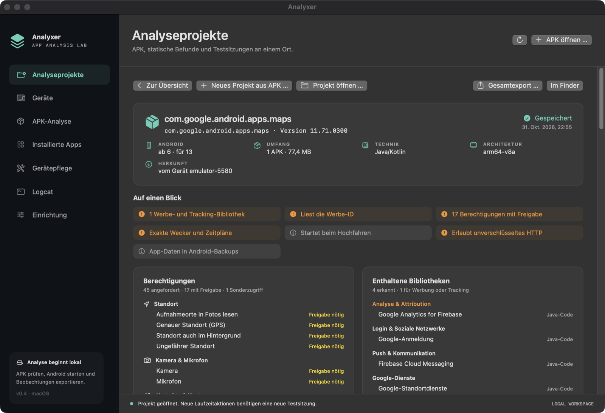
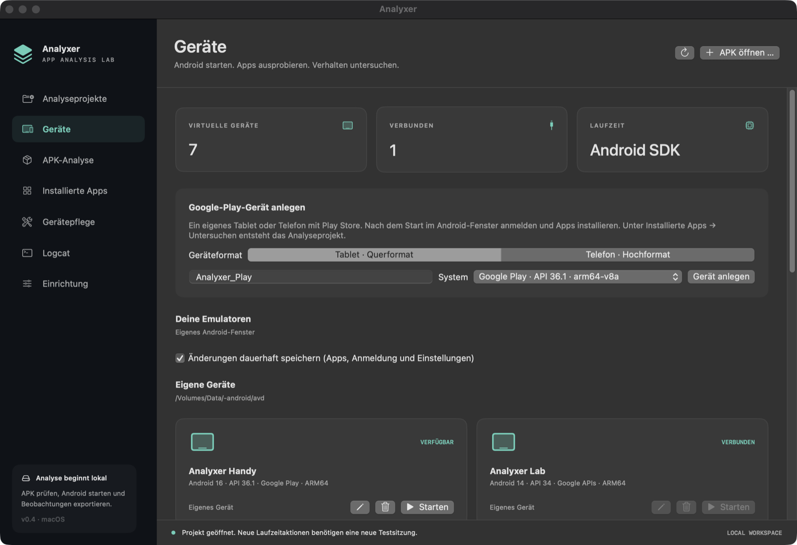

# Analyxer

[English](README.md)

Native macOS-Arbeitsumgebung für Android-Emulatoren, APK-Analyse und Gerätepflege. Analyxer betreibt den Emulator des offiziellen Android SDK in einem eigenen Fenster und ergänzt, was das SDK der Kommandozeile überlässt: dauerhafte Google-Play-Geräte, einen Steckbrief in Klartext für jede untersuchte App, Analyseprojekte, die Belege zusammenhalten, Codeanalyse mit [REA](https://github.com/morluto/rea) und JADX, gezielte Laufzeitbeobachtung mit Frida und Pflegewerkzeuge für das Gerät selbst.

Die App ist in SwiftUI geschrieben, hat keine Swift-Abhängigkeiten von Drittanbietern und arbeitet vollständig lokal. Sie lädt keine APKs irgendwohin hoch.

Version 0.4 · macOS 14 oder neuer · getestet auf Apple Silicon mit ARM64-Images von Android 14 bis 16. Intel-Macs sind nicht getestet.



## Funktionen

- **Geräte.** Google-Play-Tablets oder -Telefone aus offiziellen Systemimages anlegen, dauerhaft (Apps und Anmeldung bleiben erhalten) oder temporär starten, eigene Geräte umbenennen und löschen. Geräte aus Android Studio erscheinen in einem eigenen Abschnitt und lassen sich starten, aber nie löschen. Jede Karte zeigt das System, etwa „Android 16 · API 36.1 · Google Play · ARM64“.
- **Steckbrief.** Jedes Analyseprojekt beginnt mit einem Steckbrief in Klartext: Android-Versionen, Umfang, Technik (Unity mit IL2CPP, Flutter, React Native …), Architekturen, Herkunft, Auffälligkeiten auf einen Blick, Berechtigungen nach Themen mit Androids Einstufung, erkannte Bibliotheken nach Zweck (Werbung, Analyse, Absturzberichte, Zahlungen …) und was andere Apps oder Links starten können.
- **Analyseprojekte.** Ein Projekt hält eine App-Version (einzelne APK oder installierter Basis-/Split-Satz) mit statischen Befunden und beliebig vielen dokumentierten Testsitzungen zusammen: Installation, Start, Screenshots, App-Logcat, Notizen. Alles wird sofort mit SHA-256-Hash und Zeitstempel gespeichert und lässt sich exportieren und wieder öffnen.
- **Code und Datenflüsse.** Die unveränderte Projekt-APK an REA/JADX übergeben, um Klassen zu suchen, Methoden aufzulisten, zu dekompilieren und Referenzen zu verfolgen. Argumente und Rückgaben ausgewählter Java-Methoden in der laufenden App mit REA/Frida beobachten. Mobilfunk-/WAN-Verkehr eines SDK-Emulators aufzeichnen oder ein PCAP importieren.
- **Installierte Apps und Gerätepflege.** Alle Apps eines Geräts mit Speicherbedarf, Herkunft und letzter Nutzung auflisten; nach Rückfrage deaktivieren, für den Benutzer entfernen, wiederherstellen oder deinstallieren. Sehen, wo der Speicher bleibt, alle App-Caches leeren und Restordner deinstallierter Apps entfernen. Alles läuft über ADB, ohne Root und ohne App auf dem Gerät.
- **Werkzeugverwaltung.** Die Einrichtung prüft jedes externe Werkzeug, erklärt, was fehlt, und installiert es auf Wunsch aus der offiziellen Quelle, geprüft gegen die veröffentlichte Prüfsumme.
- **Englisch und Deutsch.** Die Oberfläche folgt der Systemsprache; **Einrichtung → Sprache** legt sie abweichend fest.



## Erste Schritte

### 1. Bauen

Du brauchst Xcode mit Swift 6 oder neuer.

```sh
scripts/build-app.sh
open '/Applications/Analyxer.app'
```

Das Skript baut `dist/Analyxer.app`, signiert es ad hoc und ersetzt `/Applications/Analyxer.app`. Die App ist nicht notarisiert; fertige Binärversionen gibt es noch nicht.

### 2. Werkzeuge einrichten

**Einrichtung** öffnen. Die App sucht das Android SDK in `ANDROID_HOME`, danach `ANDROID_SDK_ROOT`, danach `~/Library/Android/sdk`; du kannst einen anderen Ordner wählen. Unter **Analysewerkzeuge** prüft sie:

| Werkzeug | Benötigt für |
|---|---|
| Java Development Kit (17 oder neuer, installiert wird 25) | JADX und die Android-Command-line-Tools |
| Android SDK | Emulator, `adb`, `aapt2`, `apkanalyzer`, `avdmanager`, `sdkmanager` |
| Node.js (eine von REA unterstützte Version) | REA und den Bau der Frida-Bridge |
| REA | Codeanalyse und Prozessbeobachtung |
| JADX headless MCP | Java- und Kotlin-Dekompilierung für REA |
| Frida-Java-Bridge | Beobachtung von Java-Methoden im App-Prozess |
| frida-server | läuft auf dem Analysegerät; muss zu REAs Frida-Version passen |

Zuerst einen **Werkzeugordner** wählen: Die App schlägt `analyxer-tools` neben dem SDK vor, jeder Ordner ist möglich, etwa auf einer externen Platte. **Installieren …** nennt Quelle und ungefähre Größe, bevor etwas heruntergeladen wird. Downloads kommen ausschließlich aus den offiziellen Quellen (Adoptium, nodejs.org, npm, GitHub-Releases, Googles SDK-Repository) und werden vor dem Entpacken gegen ihren veröffentlichten SHA-256 oder SHA-1 geprüft. Das Android SDK zeigt Googles Lizenzen, die du selbst annimmst. Details: [Einrichtung und Werkzeuge](docs/de/setup.md).

Bereits vorhandene Werkzeuge werden erkannt und an ihrem Ort verwendet.

### 3. Erste Schritte

1. **Geräte → Google-Play-Gerät anlegen**, das Gerät starten, **Google Play öffnen** wählen und im Android-Fenster anmelden.
2. Eine App aus dem Store installieren, danach **Installierte Apps → Apps laden → Untersuchen …**, um sie in ein neues Analyseprojekt zu übernehmen. Oder **APK öffnen …** für eine APK-Datei.
3. Den Steckbrief lesen, **Details & Belege** für die Rohdaten öffnen, eine Testsitzung beginnen und die Beobachtungen festhalten.

Wo die eigenen Geräte liegen, legt **Einrichtung → Eigene Geräte** fest. Standard ist ein Ordner `avd` neben dem SDK.

## Dokumentation

- [Einrichtung und Werkzeuge](docs/de/setup.md): Werkzeugverwaltung, Quellen, Prüfsummen, Werkzeugprofil, Kommandozeile
- [Analyseprojekte](docs/de/project-workflow.md): Ablauf, Dateiformat, Integrität, statische Analyse
- [Google-Play-Geräte](docs/de/google-play.md): Geräte anlegen und verwalten, installierte Apps importieren, Grenzen
- [Code- und Datenflussanalyse](docs/de/deep-analysis.md): REA/JADX, Frida-Methodenbeobachtung, Netzwerkmitschnitt

Die englischen Seiten in [docs](docs) sind die Hauptfassung.

## Verantwortungsvoller Einsatz

Analyxer ist für Apps gedacht, die du untersuchen darfst: eigene Apps, Apps, die du im Auftrag ihres Inhabers testest, und Forschung, die das Gesetz und die für dich geltenden Bedingungen beachtet. Dekompilieren, Beobachten oder Weitergeben fremder Apps kann durch Urheberrecht, Lizenzbedingungen oder örtliches Recht eingeschränkt sein. Die Gerätepflege nicht auf Geräten verwenden, die dir nicht gehören oder die du nicht verwaltest. Du bist verantwortlich dafür, was du analysierst und was du mit den Ergebnissen tust.

Die Beobachtung über Frida benötigt ein vorbereitetes Analysegerät. Die App rootet keine Geräte, installiert keine Zertifikate und umgeht kein Zertifikat-Pinning.

Sicherheitsprobleme in Analyxer bitte vertraulich melden, wie in [SECURITY.md](SECURITY.md) (englisch) beschrieben.

## Entwicklung

```sh
CLANG_MODULE_CACHE_PATH="$TMPDIR/analyxer-clang-cache" swift test --disable-sandbox
swift run --disable-sandbox analyxer-cli diagnose
swift run --disable-sandbox analyxer-cli setup check
swift run --disable-sandbox analyxer-cli care emulator-5554
swift run --disable-sandbox analyxer-cli profile path/to/project.androidlab
```

`--disable-sandbox` betrifft den Swift-Paketmanifest-Prozess, nicht macOS-Systemschutz. Die Testsuite (86 Tests) benötigt kein Android-Gerät.

- `Sources/Analyxer`: SwiftUI-Oberfläche
- `Sources/AnalyxerCore`: SDK- und Prozessadapter, statische Analyse, Steckbrief, Projekte, Gerätepflege, Werkzeugverwaltung
- `Sources/AnalyxerCLI`: Diagnose, Einrichtung und Integrationstests
- `Resources/Localization`: deutsche Übersetzung (Englisch ist die Ausgangssprache)
- `fixture/`, `scripts/build-fixture.sh`: eine synthetische Test-App, mit dem lokalen SDK aus dem Quellcode gebaut

End-to-End-Tests laufen nur auf einem ausdrücklich genannten Emulator und akzeptieren ausschließlich das synthetische Fixture-Paket:

```sh
scripts/build-fixture.sh
swift run --disable-sandbox analyxer-cli smoke emulator-5580 \
  .local/fixture/analyxer-fixture.apk .local/smoke
```

`care SERIAL` gibt Speicher, die größten Apps und App-Reste aus und ändert nichts. `care-smoke EMULATOR-SERIAL` führt jede Pflegeaktion einmal aus (YouTube deaktivieren und wiederherstellen, Caches leeren, künstlichen App-Rest anlegen und löschen) und ist nur für einen entbehrlichen Emulator gedacht.

### Offene Arbeit

Store-Anmeldung und Downloads mit einem Benutzerkonto sind noch nicht durchgehend geprüft. Nicht umgesetzt: AVD-Klonen, eingebettetes Android-Bild, Keymapping und Gamepads, Snapshotverwaltung, native/JNI-Messpunkte, vollständige WLAN-Aufzeichnung, notarisierte Releases.

## Lizenz

MIT, siehe [LICENSE](LICENSE). Die externen Werkzeuge (Android SDK, JDK, Node.js, REA, JADX, Frida) sind weder Teil dieses Repositorys noch der App und stehen unter eigenen Lizenzen; siehe [Hinweise zu Fremdwerkzeugen](THIRD_PARTY_NOTICES.md) (englisch).

Android ist eine Marke der Google LLC. Analyxer ist ein unabhängiges Projekt, das weder mit Google verbunden ist noch von Google unterstützt wird.
